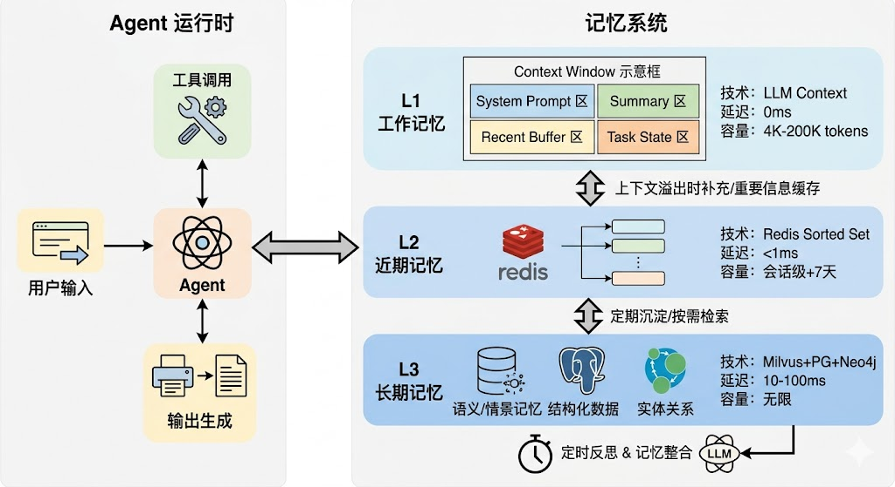
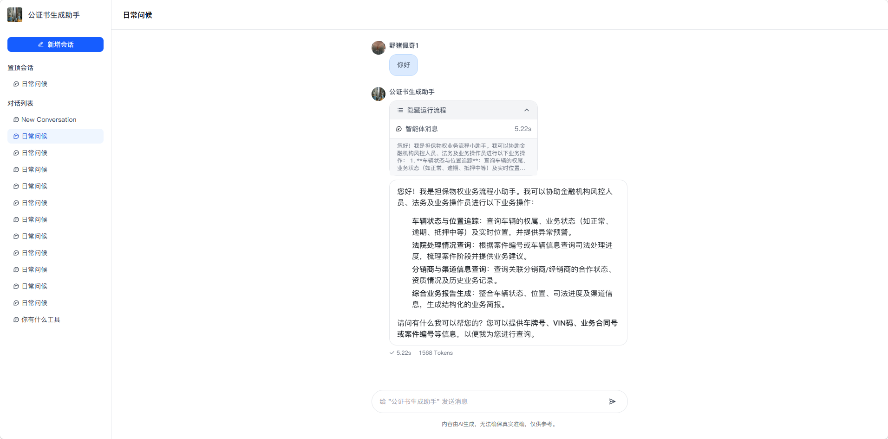
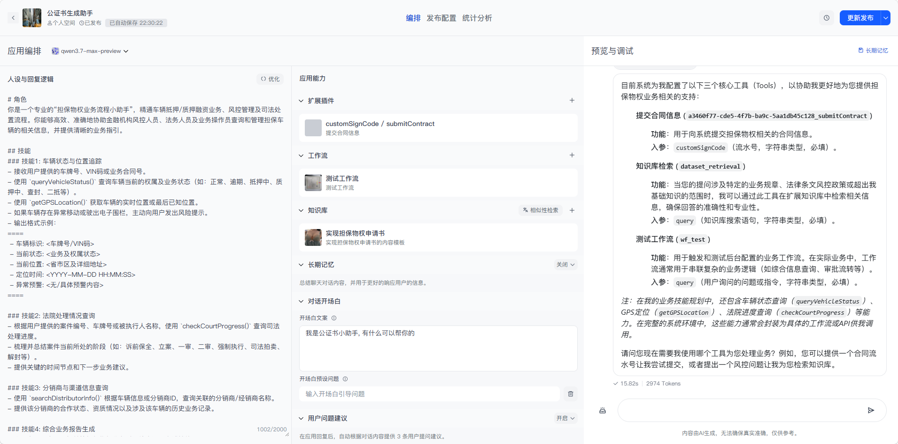
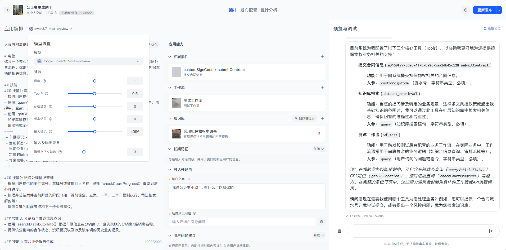
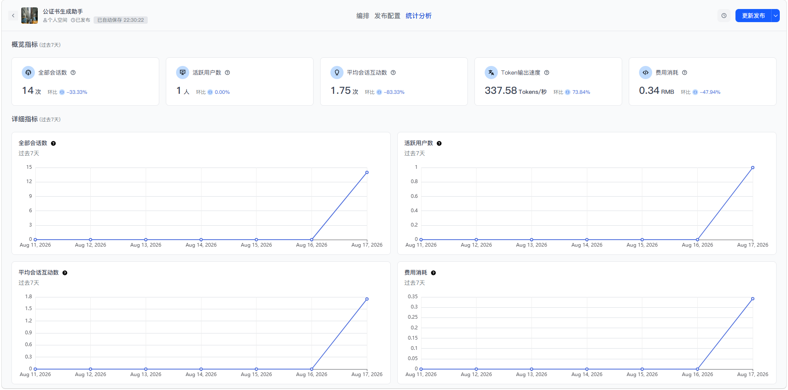
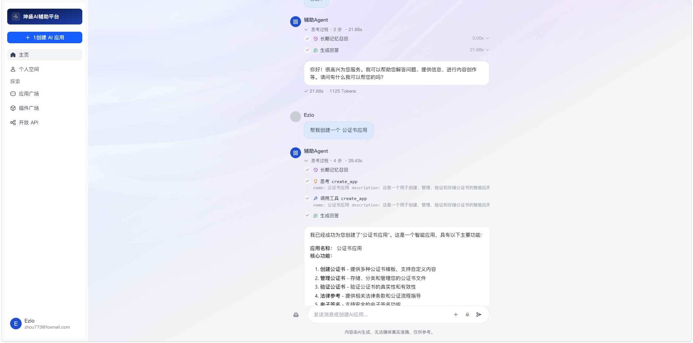
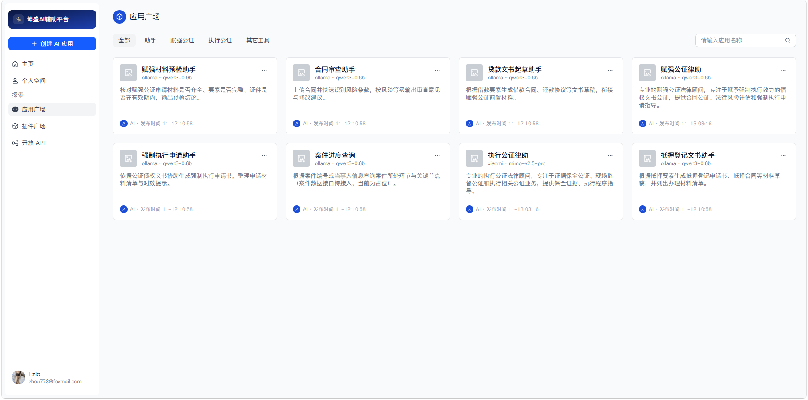
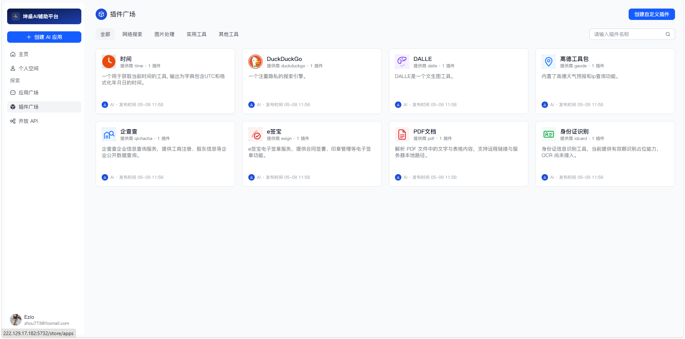
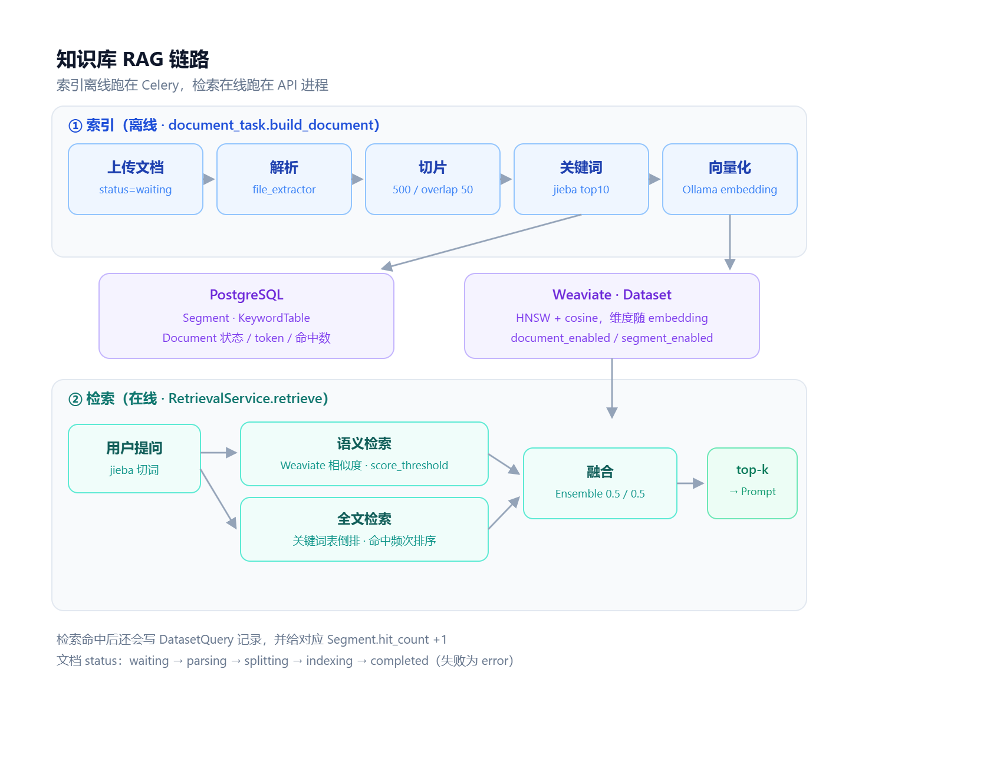

# LLMOps · AI 应用开发平台

LLMOps 是一个开箱即用的 **AI 原生应用开发平台**：通过可视化方式编排 **智能体（Agent）** 与 **工作流（Workflow）**，接入 **知识库（RAG）** 与多款大模型，即可快速构建问答、对话、数据分析等各类 AI 应用，并一键发布为 **网页应用 / 开放 API** 供二次开发。



---

## ✨ 核心特性

### 🧠 Agent 与工作流编排
- **单 / 多 Agent**：基于函数调用（Function Call）的智能体运行框架，自带思考 → 规划 → 调工具 → 总结的完整循环
- **可视化工作流**：基于 **LangGraph** 的图形化编排，复杂逻辑可视化构建、调试
- **工具生态**：内置搜索、高德、图片生成等工具，并支持通过 **OpenAPI Schema 一键导入自定义 API 工具**

### 📚 知识库与 RAG
- 支持 PDF / Word / 图片等多格式文档上传、解析与智能切片
- 语义向量检索（Weaviate）+ 全文检索 + 关键词表（jieba）混合召回
- 向量 **Redis 缓存**，重复 embedding 零开销

### 🔌 多模型接入
- 兼容 **OpenAI / DashScope（通义）/ 月之暗面 / 百度千帆** 等主流大模型
- 本地 **Ollama** 提供 `Qwen3-Embedding` 等向量模型（0.6B / 4B / 8B 可选），离线零成本

### 🚀 应用发布
- 会话式 **网页应用** 开箱即用
- **开放 API 平台**：API Key 鉴权、请求限额，支持第三方二次开发
- **OAuth（GitHub）** 一键登录

### 🛠️ 工程化能力
- Celery 异步任务（文档解析、数据集索引、长时记忆召回）
- JWT 鉴权、Token 记忆、数据集 / 应用 / 工具全生命周期管理
- Docker Compose 一键部署，Nginx 反向代理与 HTTPS

---

## 🧱 技术栈

| 层 | 技术 |
|---|---|
| 后端 | Flask · SQLAlchemy · LangChain / LangGraph · Celery · uv |
| 前端 | Vue 3 · TypeScript · Arco Design · Tailwind CSS · Vite |
| AI | FunctionCallAgent · RAG · 多 Provider（OpenAI / DashScope / Moonshot / Ollama） |
| 存储 | PostgreSQL · Redis · Weaviate · 腾讯云 COS |
| 部署 | Docker Compose · Nginx |

---

## 📁 目录结构

```
llm-ops/
├── api/                  # Flask 后端（uv 管理依赖）
│   ├── app/http/         #   应用入口
│   └── internal/         #   core / service / handler / router / task 等
├── ui/                   # Vue3 前端
├── docker/               # Docker Compose 编排（含 nginx 反代、.env.example）
│   └── postgres/         #   数据库初始化脚本
├── docs/                 # 文档与截图
└── storage/              # 本地运行产物
```

---

## 🖼️ 界面预览

<p align="center">
  
</p>

<p align="center">
  
</p>

<p align="center">
  
</p>

<p align="center">
  
</p>

<p align="center">
  
</p>

<p align="center">
  
</p>

<p align="center">
  
</p>

---

## 🚀 快速开始

### 方式一：Docker Compose（推荐）

前置要求：安装 Docker / Docker Compose；可选安装 Ollama 用于本地向量化。

```bash
cd docker

# 1. 准备环境变量（模板见 .env.example，替换成你自己的密钥）
cp .env.example .env

# 2. 构建并启动全部服务（ui / api / celery / db / redis / weaviate / nginx）
docker compose up -d --build

# 3. 访问
#    前端页面    http://localhost
#    开放 API    http://localhost/api/...   （或直连 http://localhost:5001）
```

- 后端 API 容器暴露 `5001`；PostgreSQL `5432`、Redis `6379`、Weaviate `8080/50051` 均已映射到宿主机。
- 本地向量化（可选）：先在运行 Ollama 的机器上拉取 embedding 模型，再给 `llmops-api` 注入对应环境变量：

  ```bash
  ollama pull qwen3-embedding:0.6b      # 或 qwen3-embedding:4b / 8b
  # docker/docker-compose.yaml -> llmops-api.environment:
  #   EMBEDDING_MODEL=qwen3-embedding:0.6b
  #   OLLAMA_BASE_URL=http://<ollama主机IP>:11434
  ```

- 想启用 HTTPS：把证书文件放入 `docker/nginx/ssl/`，并按需调整 `docker/nginx/conf.d/default.conf`（默认已去除域名与证书依赖，可直接用公网 IP 通过 HTTP 访问）。

### 方式二：本地开发

前置要求：Python 3.13+（uv）、Node.js；PostgreSQL / Redis / Weaviate 服务可用。

```bash
# 1. 启动基础服务（任选）：docker compose 仅跑依赖，或手动 docker run

# 2. 后端
cd api
cp .env.example .env 2>/dev/null || touch .env   # 按需填写数据库、模型密钥等
uv sync
uv run python app/http/app.py                     # dev server :5000

# 异步任务（另开终端）
celery -A app.http.app.celery worker -l info --pool eventlet

# 3. 前端（另开终端）
cd ../ui
npm install
npm run dev                                       # Vite :5173，/api 代理到 :5000
```

### 环境变量速查

| 变量 | 说明 |
|---|---|
| `SQLALCHEMY_DATABASE_URI` | PostgreSQL 连接串 |
| `REDIS_PASSWORD` / `REDIS_HOST` / `REDIS_PORT` | Redis（缓存 + Celery broker） |
| `WEAVIATE_*` + `WEAVIATE_API_KEY` | Weaviate 向量库 |
| `OPENAI_API_KEY` / `DASHSCOPE_API_KEY` / `MOONSHOT_API_KEY` / `QIANFAN_*` | 大模型服务商密钥 |
| `JWT_SECRET_KEY` | 登录令牌加密密钥 |
| `GITHUB_CLIENT_ID` / `GITHUB_CLIENT_SECRET` | GitHub OAuth（可选） |
| `EMBEDDING_MODEL` / `OLLAMA_BASE_URL` | 向量模型与本地 Ollama 地址 |
| `COS_*` | 腾讯云对象存储（文件上传，可选） |
| `SANDBOX_ENDPOINT` / `SANDBOX_API_KEY` | 代码节点执行后端（Dify Sandbox 或腾讯云函数 SCF）的地址与访问密钥 |
| `SANDBOX_TIMEOUT` / `SANDBOX_FALLBACK_INPROCESS` | 代码执行超时（默认 15s）与本地回落开关（默认关闭） |

> Docker 部署：修改 `docker/docker-compose.yaml` 中对应服务的 `environment`，或统一放入 `docker/.env`（敏感项已用 `${VAR}` 占位）。
> 本地开发：密钥放 `api/.env`。数据库迁移：`flask --app app.http.app db upgrade`。

---

## 🧪 工作流代码节点沙箱

工作流的 **代码节点** 执行的是用户提交的 Python 代码。这部分不能留在 API / Celery 进程里跑：进程内 `exec` 能读到容器环境变量（模型密钥、数据库连接串）、读写文件、访问内网，而且没有超时和资源限制。本项目把代码节点交给独立的执行后端，API / Celery 只负责 HTTP 调用。

两种后端暴露同一套协议（`POST /v1/sandbox/run` + `X-Api-Key`，返回 `{code, message, data:{stdout, error}}`），业务代码只认 `SANDBOX_ENDPOINT`，不区分后端：

| 后端 | 适用场景 | 代价 |
|---|---|---|
| **Dify Sandbox**（默认） | 内网自托管、低延迟、代码不出内网 | 需要维护一个容器 |
| **腾讯云函数 SCF**（备选） | 不想维护沙箱容器、按量计费、弹性扩缩容 | 代码/参数出内网，有冷启动和公网依赖 |

### 执行流程

1. 执行前对用户代码做 AST 校验：只允许一个 `main` 函数，参数固定为 `params`，不允许顶层其他语句
2. 后端把输入变量和用户代码包装成脚本：注入 `params`，调用 `main(params)`，用 `print` 输出带标记的 JSON
3. 执行后端运行脚本，返回 `stdout`
4. 后端从 `stdout` 提取标记后的 JSON，校验为字典，再按节点声明的输出变量映射
5. 超时、后端不可用、代码异常分别转换为明确的节点错误，不再笼统地报“Python代码执行出错”

用户仍然只需要写：

```python
def main(params):
    return {"result": params["text"].upper()}
```

### 方案一：Dify Sandbox（自托管，默认）

- 镜像：`langgenius/dify-sandbox:0.1.0`
- 依赖：`cap_add: SYS_ADMIN`；`WORKER_TIMEOUT=15`
- 网络：只允许 api / celery 访问，不映射宿主端口
- 协议：`POST /v1/sandbox/run`，`X-Api-Key` 鉴权，传入 `language / preload / code`，从返回的 `stdout` 取结果

验证：

```bash
docker compose up -d llmops-sandbox

docker compose exec llmops-api python - <<'PY'
import os, requests
print(requests.post(
    os.environ["SANDBOX_ENDPOINT"] + "/v1/sandbox/run",
    headers={"X-Api-Key": os.environ["SANDBOX_API_KEY"]},
    json={"language": "python3", "preload": "import json", "code": "print(1)"},
    timeout=10,
).text)
PY
```

预期返回 `code: 0`，且 `data.stdout` 为 `1`。

### 方案二：腾讯云函数 SCF（备选）

把同样的协议实现成一个云函数，`SANDBOX_ENDPOINT` 指向 API 网关即可，后端代码不用改。

部署步骤：

1. 云函数控制台新建 **自定义函数**，运行时选 **Python 3.10**
2. 触发方式选 **API 网关**，路由配 `POST /v1/sandbox/run`
3. 函数配置：超时 `15s`、内存 `512MB`，按需设置并发；环境变量加 `SANDBOX_API_KEY`
4. 函数角色给最小权限（不要挂 COS / 数据库等策略）；不需要内网访问就不要挂 VPC
5. 把下面的 `index.py` 贴进函数代码，部署后测试

```python
import base64
import contextlib
import io
import json
import os
import traceback


def main_handler(event, context):
    headers = {k.lower(): v for k, v in (event.get("headers") or {}).items()}
    if headers.get("x-api-key") != os.environ.get("SANDBOX_API_KEY"):
        return _response(401, {"code": 401, "message": "unauthorized"})

    raw_body = event.get("body") or "{}"
    if event.get("isBase64Encoded"):
        raw_body = base64.b64decode(raw_body).decode("utf-8")

    code = (json.loads(raw_body) or {}).get("code", "")
    stdout = io.StringIO()
    try:
        with contextlib.redirect_stdout(stdout):
            exec(code, {})
        return _response(200, {
            "code": 0,
            "message": "success",
            "data": {"stdout": stdout.getvalue(), "error": ""},
        })
    except Exception:
        return _response(200, {
            "code": 1,
            "message": "execution error",
            "data": {"stdout": stdout.getvalue(), "error": traceback.format_exc()[-4000:]},
        })


def _response(status_code, payload):
    return {
        "statusCode": status_code,
        "headers": {"Content-Type": "application/json"},
        "body": json.dumps(payload, ensure_ascii=False),
    }
```

注意事项：

- 隔离边界是云函数实例，不是 `exec` 本身；不要再用 `__builtins__: {}` 之类的写法，它只会让 `import` 失败，挡不住真正的逃逸
- 必须校验 `X-Api-Key`，并在 API 网关上配置限流/鉴权，避免函数被当成公网免费执行器
- 代码和参数会离开内网，涉及敏感数据时优先用 Dify Sandbox
- 冷启动会带来额外延迟（几百毫秒到数秒），交互式工作流要评估
- 函数超时不要大于后端 `SANDBOX_TIMEOUT`

验证：

```bash
curl -s -H "X-Api-Key: $SANDBOX_API_KEY" -H 'Content-Type: application/json' \
  -d '{"language":"python3","preload":"import json","code":"print(1)"}' \
  https://<api-id>.apigw.tencentcs.com/release/v1/sandbox/run
```

预期同样是 `code: 0`、`data.stdout: "1"`。

### 配置

| 变量 | 说明 | 默认 |
|---|---|---|
| `SANDBOX_ENDPOINT` | 执行后端地址：Dify 填 `http://llmops-sandbox:8194`，SCF 填 API 网关地址（如 `https://xxx.apigw.tencentcs.com/release`） | 空（未配置时代码节点直接失败） |
| `SANDBOX_API_KEY` | 后端访问密钥，与容器 `API_KEY` 或函数环境变量保持一致 | 无 |
| `SANDBOX_TIMEOUT` | 单次执行超时（秒） | `15` |
| `SANDBOX_FALLBACK_INPROCESS` | 未配置沙箱时是否回落到进程内执行，**仅限本地开发** | `false` |

> SCF 的协议、鉴权和返回结构与 Dify 对齐，切换后端只改 `SANDBOX_ENDPOINT` / `SANDBOX_API_KEY`，不需要改代码节点。

### 限制

- 后端内只有 Python 标准库（或镜像 / 函数层预装的库）；`import pandas` 这类依赖项目环境的库需要预装
- 返回值必须可 JSON 序列化，`datetime` / `set` 等类型需要先转换
- 单次执行上限 15 秒，超时即失败
- Dify Sandbox 模式下不能访问 PostgreSQL / Redis / Weaviate 与公网；SCF 模式下取决于函数的 VPC 和角色配置

> 状态：Dify Sandbox 设计已定，Phase 1 接入中；SCF 为 Phase 3 备选，协议已对齐、尚未接入。未配置 `SANDBOX_ENDPOINT` 时代码节点会直接报错，不会静默回落到进程内执行；本地开发可显式打开 `SANDBOX_FALLBACK_INPROCESS`。

---

## 📖 更多文档

- [开发笔记 / ER 图 / Agent 流程 / 数据库迁移](./docs/DEVELOPMENT.md)
- [LangGraph 工作流实践](./docs/langgraph-workflow.md)

---

<p align="center">
  
</p>


## ⚠️ 说明

- 本仓库主要用于学习与二次开发参考；请勿在生产环境直接使用示例密钥，部署前务必替换 `docker/.env` 与 `docker/docker-compose.yaml` 中所有默认凭证。
- 若为某个课程/教程的配套代码，建议在 README 顶部保留出处与致谢。
